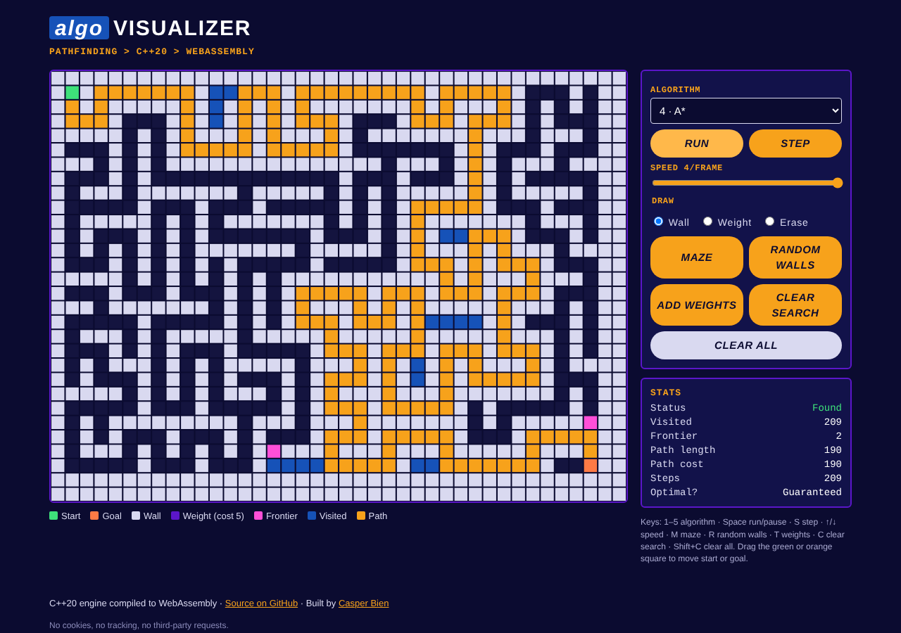

# AlgoVisualizer

[](https://github.com/czes1ek/algo-visualizer/actions/workflows/ci.yml)
[](https://czes1ek.github.io/algo-visualizer/)
[](LICENSE)

**▶ Live demo: https://czes1ek.github.io/algo-visualizer/** (runs in the browser, phones included)

An interactive pathfinding visualizer written in C++20. Draw walls and weighted terrain, drop a start and a goal, and watch **BFS, DFS, Dijkstra, A\*** and **Greedy Best-First** explore the grid one node at a time. The same dependency-free C++ engine runs as a native **SFML 3** desktop app and, compiled with **Emscripten**, as **WebAssembly** in the browser.



## Features
- Five search algorithms, animated step by step, with live stats: nodes visited, frontier size, path length, path cost, and whether the result is guaranteed optimal.
- Weighted cells (cost 5) that show why Dijkstra and A* beat BFS on weighted grids.
- Seeded maze generator (recursive backtracker), random walls, random weights.
- Mouse and touch drawing; drag the start and goal anywhere.
- Speed control from 1 step per frame to instant.
- Deterministic: neighbours expand Up, Right, Down, Left, and heap ties break by insertion order, so every run can be reproduced and unit-tested.

## Algorithms
| Algorithm | Frontier | Uses weights | Shortest path guaranteed |
|---|---|---|---|
| BFS | queue | no | yes, by move count (unweighted grids) |
| DFS | stack | no | no |
| Dijkstra | min-heap on g | yes | yes |
| A* | min-heap on g + h (Manhattan) | yes | yes (admissible heuristic) |
| Greedy Best-First | min-heap on h | cost reported only (ignored when choosing) | no |

## Controls
| Action | Desktop | Browser |
|---|---|---|
| Draw wall | left-drag | drag (Wall mode) |
| Draw weight | hold **W** + left-drag | drag (Weight mode) |
| Erase | right-drag | right-drag or Erase mode |
| Move start / goal | drag the green / orange cell | same |
| Algorithm | **1–5** | dropdown or **1–5** |
| Run / pause | **Space** | Run button or **Space** |
| Single step | **S** | Step button or **S** |
| Speed | **↑ / ↓** | slider or **↑ / ↓** |
| Maze / random walls / weights | **M / R / T** | buttons or **M / R / T** |
| Clear search / clear all | **C / Shift+C** | buttons or **C / Shift+C** |

## Build

Requires CMake ≥ 3.28, a C++20 compiler and Ninja. SFML 3 is used from your system if `find_package` finds it; otherwise CMake fetches SFML 3.0.2 automatically. Catch2 is fetched for the tests.

**macOS**
```sh
brew install cmake ninja sfml
cmake -S . -B build -G Ninja -DCMAKE_BUILD_TYPE=Release
cmake --build build && ctest --test-dir build
./build/algoviz
```

**Windows (MSYS2 UCRT64)**
```sh
pacman -S --needed mingw-w64-ucrt-x86_64-{gcc,cmake,ninja,sfml}
cmake -S . -B build -G Ninja -DCMAKE_BUILD_TYPE=Release
cmake --build build && ctest --test-dir build
./build/algoviz.exe
```

**Linux (Debian/Ubuntu)**
```sh
sudo apt install git g++ cmake ninja-build libxrandr-dev libxcursor-dev libxi-dev libudev-dev libgl1-mesa-dev libfreetype-dev
cmake -S . -B build -G Ninja -DCMAKE_BUILD_TYPE=Release
cmake --build build && ctest --test-dir build
./build/algoviz
```

**Web (Emscripten)**
```sh
emcmake cmake -S . -B build-web -DCMAKE_BUILD_TYPE=Release
cmake --build build-web
mkdir -p site && cp web/* build-web/algoviz.js build-web/algoviz.wasm site/ && rm site/bindings.cpp
python3 -m http.server -d site 8000   # open http://localhost:8000
```

`./build/algoviz --demo` opens straight into a maze with A* running; `--smoke-test` does the same and exits 0 once A* reaches the goal (or 1 if it hasn't within 10 seconds).

## Architecture
```
            core/  (pure C++20, no dependencies)
            Grid · Search (BFS/DFS/Dijkstra/A*/Greedy) · maze generation · stats
                     │                                   │
     app/  SFML 3 desktop renderer             web/  embind bindings → Canvas 2D (JS)
     (built-in 5×7 pixel font, no assets)      → GitHub Pages
                     │
            tests/  Catch2 unit tests (core only)
```
- `Search::step()` expands exactly one node, which is what makes the animation possible. Both front ends just read the per-cell overlay (frontier, visited, path).
- The web build shares that overlay with JavaScript through a zero-copy `typed_memory_view`.
- Everything compiles with `-Wall -Wextra -Wpedantic -Wconversion -Wshadow`, and CI treats warnings as errors.

## Testing
`ctest` runs the Catch2 suite: path validity for every algorithm, known shortest-path lengths, unreachable goals, weighted grids where the cheapest path is longer than the shortest, determinism and heap tie-breaking, DFS/BFS expansion order, no cell expanded twice, path cost matching the path, endpoints that restore the cells they're dragged over, and maze reproducibility and connectivity across several sizes and seeds. CI builds and tests on Linux, macOS and Windows (MSYS2), runs a headless smoke test of the desktop app (it fails unless A* solves the demo maze), and deploys the web demo to GitHub Pages.

## License
MIT. See [LICENSE](LICENSE).

---
Built by **Casper Bien** · [casperbien.com](https://casperbien.com) · [github.com/czes1ek](https://github.com/czes1ek)
